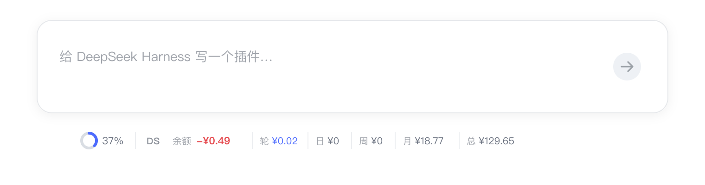
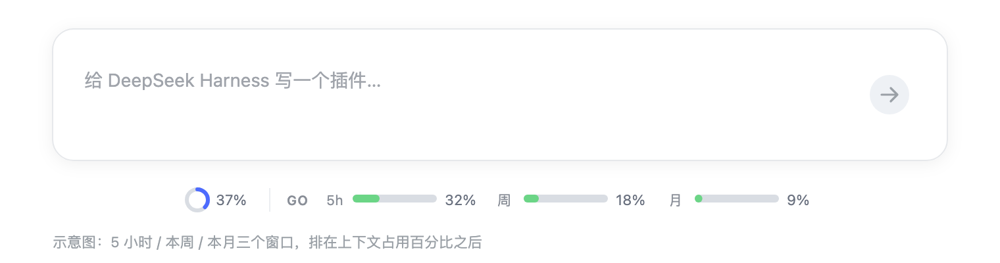
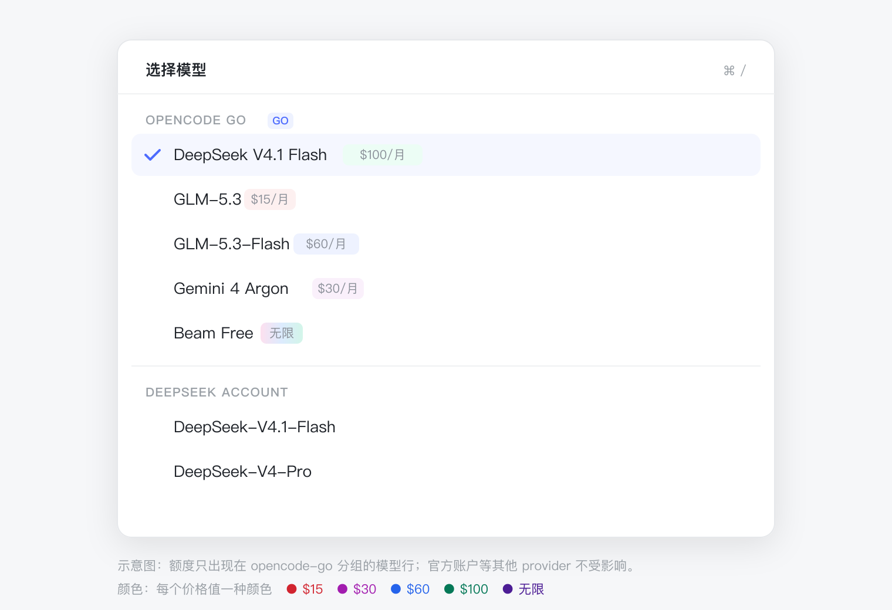
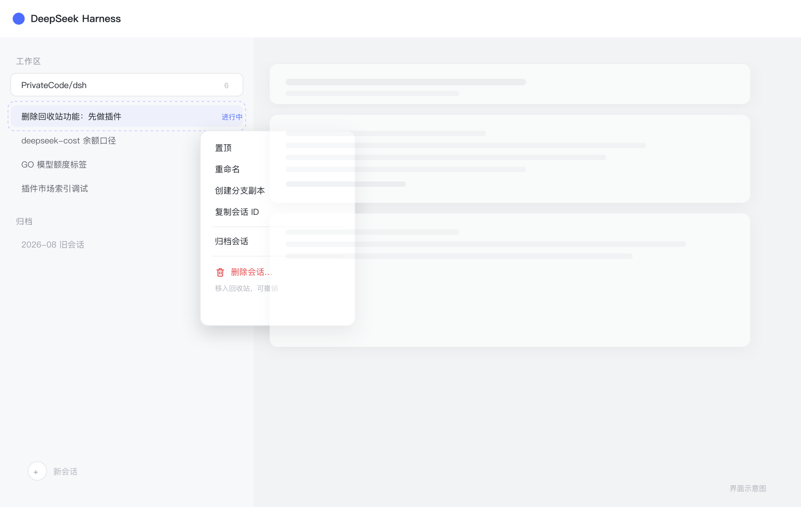
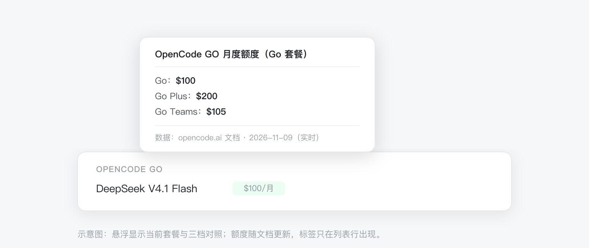

# skyrocks · DSH plugins

Five small plugins for [DeepSeek Harness](https://github.com/deepseek-ai/deepseek-harness) (`dsh`):
two dock balance and quota readouts under the composer, one labels every GO model with its monthly
limit in the model picker, one turns "switch model" into tools the model itself can call, and one
gives sessions **real deletion** (trash + undo).

| Plugin | What it does | Shape |
| --- | --- | --- |
| [dsh-deepseek-cost](https://github.com/skyrocks/dsh-deepseek-cost) | DeepSeek balance · current-turn / day / week / month / lifetime spend | dock under the composer |
| [dsh-go-quota](https://github.com/skyrocks/dsh-go-quota) | OpenCode GO 5-hour / weekly / monthly windows | dock under the composer |
| [dsh-go-model-limits](https://github.com/skyrocks/dsh-go-model-limits) | Official monthly limit for each OpenCode GO model, one colour per price | model menu tag |
| [dsh-model-switcher](https://github.com/skyrocks/dsh-model-switcher) | `find_models` / `switch_model` tools, so the model can look up and switch models in chat | no UI (host tools) |
| [dsh-session-trash](https://github.com/skyrocks/dsh-session-trash) | Delete a session into the trash, undo from the toast, restore or purge under Settings | session context menu + Settings page |

<p align="center">
  
</p>

<p align="center">
  
</p>

<p align="center">
  
</p>

<p align="center">
  
</p>

## Install

In the desktop app: Settings → Plugins → Add plugin, paste one of the specs below. Or use the CLI:

```sh
# DeepSeek balance & spend (CDN, reliable behind firewalls)
dsh plugin --profile desktop add "https://cdn.jsdelivr.net/gh/skyrocks/dsh-plugins@main/dist/skyrocks-dsh-deepseek-cost-0.2.3.tgz"

# OpenCode GO quota
dsh plugin --profile desktop add "https://cdn.jsdelivr.net/gh/skyrocks/dsh-plugins@main/dist/skyrocks-dsh-go-quota-0.1.9.tgz"

# OpenCode GO model monthly limits
dsh plugin --profile desktop add "https://cdn.jsdelivr.net/gh/skyrocks/dsh-plugins@main/dist/skyrocks-dsh-go-model-limits-0.1.2.tgz"

# Model switcher tools
dsh plugin --profile desktop add "https://cdn.jsdelivr.net/gh/skyrocks/dsh-plugins@main/dist/skyrocks-dsh-model-switcher-0.2.1.tgz"

# Session trash
dsh plugin --profile desktop add "https://cdn.jsdelivr.net/gh/skyrocks/dsh-plugins@main/dist/skyrocks-dsh-session-trash-0.1.1.tgz"

# Or track the GitHub default branch
dsh plugin --profile desktop add github:skyrocks/dsh-deepseek-cost
dsh plugin --profile desktop add github:skyrocks/dsh-go-quota
dsh plugin --profile desktop add github:skyrocks/dsh-go-model-limits
dsh plugin --profile desktop add github:skyrocks/dsh-model-switcher
dsh plugin --profile desktop add github:skyrocks/dsh-session-trash
```

Fully quit and relaunch DSH afterwards (host plugins load at startup). For `dsh web`, use
`--profile web`.

## Plugin index

Add this URL in the experimental plugin market's Discover tab to browse and install all five:

```
https://cdn.jsdelivr.net/gh/skyrocks/dsh-plugins@main/index.json
https://raw.githubusercontent.com/skyrocks/dsh-plugins/main/index.json
```

Requires the `@deepseek-ai/dsh-experimental-plugin-market-bundle` bundle to be enabled.

## About the monthly limit labels

It only changes the model menu: a small tag after each `opencode-go` model row, with one colour
per price value (`$15`, `$30`, `$60`, `$100` … all distinct; unlimited uses a gradient). The data comes from the
official OpenCode Go pricing docs; the host fetches and caches it (6 hours by default), with the
bundled snapshot as a fallback. No API key is needed. Official DeepSeek account and other providers show no tag.

<p align="center">
  
</p>

Note: the `/model` command popup is not covered (it has no plugin extension point), and the number
is a cap, not the remaining budget for the month.

## About session trash

DSH ships archive only: archiving hides a session and blocks further runs, but its log keeps
occupying disk. This plugin makes deletion two steps: **Delete session…** moves the directory into
`~/.dsh/trash/sessions/`, the toast offers **Undo**, and **Settings → Trash** restores or purges later.

- **Subagent children go with their parent**, so no orphaned lineage is left behind.
- **Refusals are explicit**: an open session (or child), or one with running work, is refused with
  the reason listed.
- **Attachments are shared**: they stay, so disk space is released only when the trash is emptied.

## About the model switcher

It is not a UI plugin: switching models by hand stays on the built-in `/model` popup. It registers
two tools for the model — `find_models` reads what the session can actually switch to, and
`switch_model` applies an exact pick. When one model family has several versions (say `glm-5.3` /
`glm-5.3-flash` / `glm-5.2`), the candidates are listed for you to choose instead of being guessed.

So you just say, in chat:

```
switch to glm
use the fastest one
move to deepseek reasoning
```

It needs DSH `>= 0.2.1-rc.3`; earlier builds exposed the model catalog through
`apiProxy.sessions`, an interface that has since been removed.

## Why

- Quota and spend live under the composer — no settings page, no dashboard.
- Reads only the key already configured in your DSH profile; never sent to the browser.
- Zero runtime dependencies, no native modules.
- The two docks hide themselves when the session is not on the matching provider.
- Model switching never guesses: candidates come from DSH's own catalog, and multiple versions
  are always listed for the user.
- Sessions can actually be deleted: trash first, undo any time, and no orphaned subagent rows.

## Compatibility

| Plugin | DSH |
| --- | --- |
| dsh-deepseek-cost | `>= 0.2.1-rc.2 < 0.3.0` |
| dsh-go-quota | `>= 0.2.1-rc.2 < 0.3.0` |
| dsh-go-model-limits | `>= 0.2.1-rc.3 < 0.3.0` |
| dsh-model-switcher | `>= 0.2.1-rc.3 < 0.3.0` |
| dsh-session-trash | `>= 0.2.1-rc.3 < 0.3.0` |

Node `>= 18` (the desktop build ships Node 24). Verified on macOS; Windows and Linux expected
to work.

## Privacy

- Credentials are read from the current DSH profile and used only in the host process.
- No telemetry, no third-party services.
- Only the session-trash plugin touches disk: it moves a session directory you asked to delete into
  `~/.dsh/trash` and moves it back when you restore. The other four do not modify conversation
  content: the two docks read usage metadata, the switcher only calls DSH's own model catalog and
  selection interfaces, and the limits plugin only reads the catalog and renders labels in the menu.

## License

MIT
