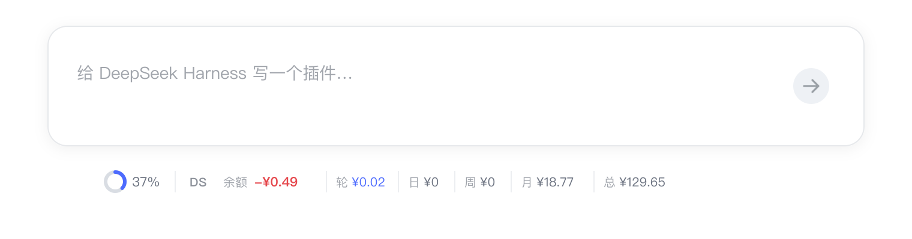
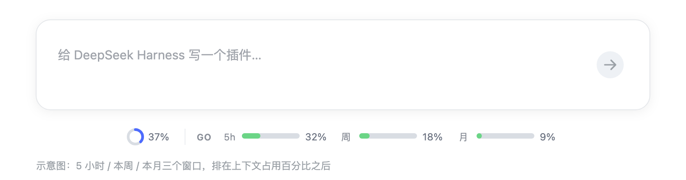

# skyrocks · DSH 插件

两个给 [DeepSeek Harness](https://github.com/deepseek-ai/deepseek-harness)（`dsh`）用的小插件。
都常驻在**对话输入框下方**，不用切页面就能看完额度与花费。

| 插件 | 显示什么 | 来源 |
| --- | --- | --- |
| [dsh-deepseek-cost](https://github.com/skyrocks/dsh-deepseek-cost) | DeepSeek 余额 · 本轮 / 今日 / 本周 / 本月 / 累计花费 | 官网账号同源数据 |
| [dsh-go-quota](https://github.com/skyrocks/dsh-go-quota) | OpenCode GO 套餐的 5 小时 / 周 / 月三窗口 | GO 账户用量 |

<p align="center">
  
</p>

<p align="center">
  
</p>

> 截图为界面示意图，实际样式跟随 DSH 主题（明 / 暗）。

## 安装

在 DSH 桌面端：设置 →「插件」→「添加插件」，粘贴下面的 GitHub 地址；或者直接用命令行：

```sh
# DeepSeek 余额与花费
dsh plugin --profile desktop add github:skyrocks/dsh-deepseek-cost

# OpenCode GO 用量
dsh plugin --profile desktop add github:skyrocks/dsh-go-quota
```

也可以跟随 GitHub 默认分支：

```sh
dsh plugin --profile desktop add github:skyrocks/dsh-deepseek-cost
dsh plugin --profile desktop add github:skyrocks/dsh-go-quota
```

装完**完全退出 DSH 再打开**（Host 插件只在启动时加载）。`dsh web` 用户把
`--profile desktop` 换成 `--profile web`。

## 一键索引（可选）

DSH 的实验性插件市场支持自定义索引。添加这个地址，就能在 Discover 里浏览并安装上面两个插件：

```
https://raw.githubusercontent.com/skyrocks/dsh-plugins/main/index.json
```

需要先启用实验性 bundle `@deepseek-ai/dsh-experimental-plugin-market-bundle`
（设置 →「插件」里启用），然后到 Discover 页添加索引地址。

## 为什么值得装

- **不用切页面**：余额、本轮花费、GO 三窗口都在输入框下方，悬浮看明细，点击立即刷新。
- **只读你已经在 DSH 里配置的 Key**：不读 `auth.json`、不扫描无关环境变量，Key 不进浏览器。
- **零运行时依赖**：纯 ESM + 浏览器 bundle，没有原生模块，目录直装也不缺包。
- **不干扰其它模型**：当前会话不是官方 DeepSeek / `opencode-go` 路由时，整条自动隐藏。
- **数据口径清楚**：余额、累计、日 / 周 / 月直接读官网接口；只有「本轮」是按官方价目表本地估算。

## 兼容性

| 项 | 要求 |
| --- | --- |
| DSH | `>= 0.2.1-rc.2 < 0.3.0` |
| Node | `>= 18`（桌面版内置 Node 24） |
| 系统 | macOS 已验证；Windows / Linux 预期可用 |

## 隐私

- 凭据只从当前 DSH profile 的配置读取，只在 Host 进程里用于请求官方接口。
- 不发送遥测，不写第三方服务。
- 两个插件都不修改会话内容，只读用量与账单元数据。

## License

MIT
